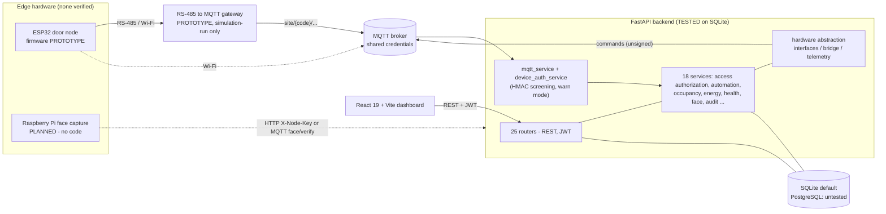
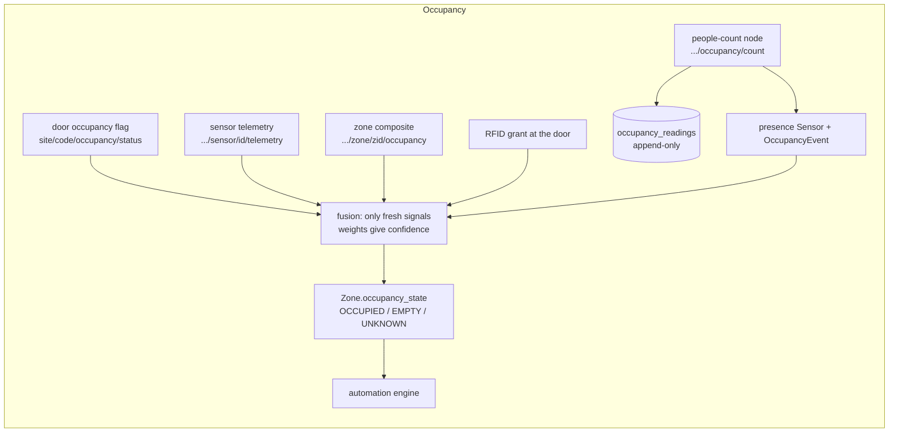

# AIU Smart Campus — System Architecture

*Reconciled with the code on 2026-11-15 (repository HEAD `e078a20`, local, not pushed). Statements were checked against source files and the automated tests named in [`FEATURE_MATRIX.md`](./FEATURE_MATRIX.md). Anything not verified is labelled. Nothing here claims PostgreSQL, browser, hardware or production verification: none was performed.*

**Maturity labels**

| Label | Meaning |
|---|---|
| `TESTED` | Implemented and exercised by automated tests that were run (SQLite) |
| `IMPLEMENTED` | Code present, not covered by a test that was run |
| `PROTOTYPE` | Code or design present, not demonstrated end to end |
| `SIMULATED` | Produces data labelled as simulated |
| `PLANNED` | Described in documents only, no code |

## 1. Component map

## 2. Backend architecture

- **Stack:** Python 3.10+, FastAPI, SQLAlchemy 2, Pydantic 2, python-jose (HS256 JWT), bcrypt, paho-mqtt, Alembic (baseline only). `TESTED`
- **Layering:** thin routers (`app/routers`, 25 modules, 168 API operations in the OpenAPI schema) call services (`app/services`, 18 modules) that hold the rules. Policy is centralised in `security.py` (RBAC and scope) and `access_authorization_service.py` (who/where/when). Models live in `app/models.py` (41 tables); request/response schemas in `app/schemas.py`.
- **Start-up** (`app/main.py` lifespan): `Base.metadata.create_all`, configuration warnings (never with secret values), a report-only check that device-identity secrets are decryptable, then background workers. Each worker is an in-process daemon thread:

| Worker | Job | Note |
|---|---|---|
| `mqtt_service` | subscribe, screen, ingest | skipped when `DISABLE_MQTT=true` |
| `staleness_watchdog` | mark silent doors offline | |
| `energy_service` | simulated power readings and the daily checkout sweep | **does not start when `DISABLE_MQTT=true`** |
| `automation_engine` | periodic zone pass | |
| `hardware_health_service` | mark silent nodes stale | |
| `emergency_override_service` | revert expired overrides | |
| `device_monitor_service` | device fault monitoring | |

  Because workers are threads inside the API process, running several API processes would run several copies of each. This has not been addressed. `IMPLEMENTED`
- **Time:** timestamps are UTC and produced with `datetime.utcnow()` (deprecated in newer Python; not yet replaced).

## 3. Frontend architecture

- React 19 and Vite 8, linted with oxlint. The only runtime dependencies are `react` and `react-dom`: there is no router library and no state library. `package.json` also lists a macOS-only optional dependency (`@rolldown/binding-darwin-arm64`).
- `src/pages/Dashboard.jsx` (about 1,100 lines) owns navigation as tab/domain state and most data loading. `src/components/AccountMenu.jsx` (about 1,200 lines) holds the profile and password UI. Feature areas are folders: `academic/`, `physical/`, `smart-building/`.
- `src/api/client.js` is the single API client. The JWT is stored in `localStorage` (key `access_control_token`). `AuthContext.jsx` decodes the token **only to show the role**; the server enforces every permission.
- The Face ID screens (`physical/FaceIdCard.jsx`, `FaceIdAdmin.jsx`) show status and administration only. There is no camera or enrolment UI, and the enrol button is permanently disabled.
- Status: lint 0 errors, 14 warnings (re-run 2026-11-15). A production build succeeded in an earlier audit and was not re-run in this phase. **No frontend unit tests exist and no browser flow was verified in the latest work.**

## 4. Authentication and authorization (users)

- **Login:** email and password, bcrypt hashes, HS256 JWT (default 60 minutes, `sub` = email, `role` claim). `POST /api/auth/refresh` re-issues a token for a valid token. There is no token revocation list. `TESTED` (`test_auth`)
- **Lockout:** repeated failures lock the email for a configurable time. State is **in memory and per process**, so it resets on restart and is not shared between processes. `TESTED`
- **Roles:** `admin`, `doctor`, `instructor`. Admins can be **scoped** (faculty, department, operational scope); `require_unrestricted_admin` is used for system-wide actions such as the device registry. `TESTED` (`test_scope_management_phase12`, `test_users_scope_gaps`, `test_org_hierarchy`)
- **Password flows:** forced change at first login, admin-approved reset with an opaque request token. `TESTED` (`test_password_reset`, `test_account_profile`)
- **Audit:** `audit_service.log` writes `audit_logs` rows for administrative actions, with filters and an investigation workflow. `TESTED`
- **At rest:** card UIDs and Face ID templates are Fernet-encrypted; card lookup uses an HMAC blind index. `TESTED` (`test_crypto`, `test_credentials`)
- **Not present:** MFA, refresh-token rotation, per-route API rate limiting, secure cookie storage of the token.

## 5. Access decision flow (doors)

1. A door node reports a card event on `site/{code}/event` (or Face ID calls `face_service.decide`).
2. The backend resolves the credential or identity to a user, then `access_authorization_service.evaluate_door_authorization` checks WHO (user and scope), WHERE (door assignment or operational scope) and WHEN (schedule or `AccessWindow`, all in UTC).
3. The result is stored on an `access_events` row with an `evidence_snapshot` of the authorization at that moment. Emergency overrides (time-boxed, maximum duration enforced) are recorded as a separate, labelled reason and never edit assignments or windows.
4. Face ID is never a grant by itself: `face_service.decide` requires a matching enrolled template **and** the same authorization evaluation, and any failure resolves to DENY or UNAVAILABLE. This function was not changed by the work in this phase. `TESTED` (`test_cyber_physical`)

Note: the node itself reports whether a card scan was granted (`data["result"]`); the backend records and, for granted events, unlocks its state. That trust in the node's result is existing behaviour.

## 6. Device Identity Registry (Phase 1B)

Separate from user login and from the shared Face ID `X-Node-Key`. Details and wire format: [`DEVICE_AUTHENTICATION.md`](./DEVICE_AUTHENTICATION.md).

- Table `device_identities`: one row per communicating **node** (not per appliance). Fields: `device_id`, optional `node_id` (matches `hardware_health.node_id`), `status` (`ACTIVE`/`REVOKED`; an unknown id simply has no row), Fernet-encrypted secret, secret version, and a fail-closed scope: allowed message kinds, zone ids and door codes.
- Admin API (`/api/device-identities...`, unrestricted admins only, audited): create (secret returned once), list, get, change scope, rotate secret, revoke. `/api/device-security/events` and `/summary` expose findings.
- Companion tables: `device_security_events` (secret-free findings, throttled) and `device_message_nonces` (replay protection).
- `TESTED` in process: `test_device_auth` (34 tests). **Not tested** with a real broker, ESP32 or Raspberry Pi. No dashboard screen exists.

## 7. MQTT message authentication and replay protection (Phase 1B)

- Envelope `aiu-hmac-v1`: JSON with `device_id`, `ts`, `nonce`, the original payload as a string, and `sig = HMAC-SHA256(secret, tag + device_id + topic + ts + nonce + sha256(payload))`. The topic is signed, so a captured message cannot be replayed on another topic or zone.
- Check order: well-formed, known, active, signature present, signature valid (constant-time compare), timestamp within the skew window, scope (message kind, zone or door code, `node_id` match), then nonce not seen before (persisted). The nonce is stored only after every other check passes.
- A message without the tag is **legacy**: recorded as `LEGACY_UNSIGNED` (info) and handled as before.
- **Modes** (`MQTT_AUTH_MODE`): `warn` (default) records findings and processes everything exactly as before; `off` disables inspection; `enforce` drops anything not verified and authorized. `enforce` is implemented and unit tested but **not enabled and never run against a live broker.** An unrecognised value falls back to `warn`.
- A verified identity only says who sent a message. It does not bypass RBAC, the handlers' zone and sensor ownership checks, automation safety rules or `face_service.decide`.

## 8. Automation Engine and policy boundaries

`services/automation_engine.py` runs a SENSE, ANALYZE, VERIFY, DECIDE, ACT, MONITOR cycle per zone, every `AUTOMATION_INTERVAL_SECONDS`. `TESTED` (`test_automation_engine`, `test_automation_rules`, `test_occupancy_confidence`, `test_automation_investigation_link`).

**Boundaries that are enforced in code (not configurable away):**

| Boundary | Behaviour |
|---|---|
| Uncertainty is not emptiness | A stale or missing signal yields UNKNOWN, never EMPTY |
| Any fresh OCCUPIED wins | Confidence scores are informational and never override this |
| Verification window | EMPTY after closing time starts a countdown; any OCCUPIED reading cancels it; action only if still EMPTY after it elapses |
| Critical loads | `CRITICAL` devices (servers, networking, security and access equipment, gateway, emergency systems) are never switched off; the refusal is logged |
| Manual-only devices | Devices with automatic control disabled are left alone |
| One control path | Shutdown uses the existing controllers in `hardware/bridge.py`, not a new route to hardware |
| Audit | Every non-silent decision is written to `automation_logs` and broadcast (unsigned) on `automation/{zone}/decision` |

**Configurable policy:** `AutomationRule` rows (database-backed, per zone or default), zone schedules, verification length, occupancy source weights (`OCCUPANCY_SOURCE_WEIGHTS`, reasoned defaults, **not measured**). There is exactly one trigger (`CONFIRMED_EMPTY`) and one action (`SHUTDOWN_NON_CRITICAL`); there is no general rule language and no rule-builder UI.

## 9. Occupancy and energy data flows

- **Counts** never identify anyone; a count of 0 is a real observation, an errored or stale sensor is UNAVAILABLE and never reads as 0. Source is `REAL` or `SIMULATED`. `TESTED` (`test_cyber_physical`, `test_occupancy_confidence`)
- **Energy, legacy path:** `energy_service` simulates per-room current for rooms with AC or plugs on, writes `power_readings`, and raises a `high_power_empty_room` alert when the room's sensor explicitly reports empty. A daily checkout sweep switches rooms off through the normal publish functions and records an `auto_shutdown` access event. `SIMULATED`
- **Energy, zone path:** a node reporting `current_power` on `.../device/{id}/state` writes an `energy_readings` row marked `REAL`; the simulator writes `SIMULATED` rows beside it. `energy_timeseries_service.aggregate` rolls up hourly to monthly buckets and never interpolates. `TESTED` (`test_energy_timeseries`)
- **Consequence:** with no real meters, all energy figures in a demo are simulated, and a model trained on them would learn the simulator. `Energy Impact Study/` is an offline analysis, not live data.
- HVAC readings and device telemetry are ingested and stored with a source flag; no HVAC control loop exists.

## 10. Hardware abstraction and simulation

- `app/hardware/interfaces.py` defines abstract sensors and controllers (`OccupancySensor`, `PowerMeter`, `RelayController`, `HVACController`, `LightingController`, `SmartPlugController`, and so on). `bridge.py` has two families: a **legacy bridge** wrapping `publish_ac/light/plug`, and a **generic bridge** that publishes `.../device/{id}/command` and also applies the change to the `Device` row so the stack stays consistent with no hardware attached. `telemetry.py` defines the one telemetry shape; `real` may be set only by code that received an actual MQTT message. `TESTED` (`test_hardware_bridge`, `test_mqtt_v2_topics`)
- **Simulation that exists:** (a) the in-process energy simulator (above); (b) `gateway/tests/fake_node_sim.py`, a Python stand-in that speaks the RS-485 protocol, driven by `gateway/tests/run_e2e_simulation.sh` (backend, pure-Python broker, gateway, virtual serial pair). That end-to-end run passed once on 2026-10-09 and was not repeated in this phase. It is **not** the ESP32 firmware. (c) Tests feed messages straight into `mqtt_service._on_message`.
- **Backend commands are unsigned** (see the security register).
- The firmware (`door_node_firmware`) has not been compiled or run in this project's verified history.

## 11. Database and Alembic strategy

- **Models:** 41 tables. SQLite by default; PostgreSQL through `DATABASE_URL`.
- **Creation:** `create_all` at start-up creates missing tables only. Older column changes were applied by 22 SQLite-only `migrate_*.py` scripts.
- **Alembic (Phase 1C):** `migrations/` with a conservative baseline `0001_baseline` that only creates missing tables from a frozen list of 41 and never alters or deletes; downgrade is refused. `schema_check.py` reports missing tables and columns read-only. Later revisions must be idempotent. Guide: [`DATABASE_MIGRATIONS.md`](./DATABASE_MIGRATIONS.md).
- **Verified:** SQLite temp databases (empty, repeated, populated with data, missing tables) and PostgreSQL **DDL compilation only**. **Not verified:** any execution on PostgreSQL. The CI job exists but has not run.
- Nothing runs migrations automatically; there is no startup version check.

## 12. Error handling and degraded operation

`DISABLE_MQTT=true` runs the API with no broker. Unknown doors, zones, malformed topics and bad payloads are logged and dropped. Missing sensor data is `None` or UNAVAILABLE, not a false reading. A fault inside device-auth screening fails open in `off`/`warn` and closed in `enforce`. Face failures never become a grant.

## 13. Known integration gaps

1. No Raspberry Pi code exists. Face ID real enrolment is not implemented; the embedding provider is `none`.
2. Firmware and gateway were never run against real hardware; the gateway chain was run with Python fake nodes only.
3. The gateway README refers to `rs485_protocol.h` and `test_cross_lang.py`, which are not in this repository.
4. No attendance feature exists anywhere; the film's attendance camera is a concept.
5. No per-device broker credentials, topic ACLs, or signed backend commands.
6. No migration auto-run, no PostgreSQL run, no frontend tests.
