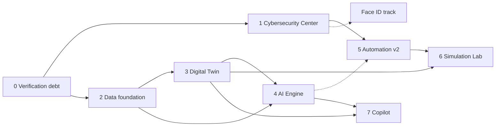

# Software roadmap

*Drafted 2026-11-15 from the verified state in [`FEATURE_MATRIX.md`](./FEATURE_MATRIX.md) and [`SECURITY_LIMITATIONS.md`](./SECURITY_LIMITATIONS.md). This is a **plan**, not a description of what exists. Everything below is `PLANNED` unless the "today" line says otherwise. Sizes (S, M, L) are rough author estimates for one developer, not commitments. No hardware work is included; each stage must stay compatible with ESP32, Raspberry Pi, MQTT gateways and real sensors being connected later without redesign.*

## Principles

1. Build on what exists (device registry, hardware abstraction, read models); do not rebuild working modules to match a vision.
2. Real and simulated data stay labelled end to end. Models are never trained on, or reported from, simulator output as if it were real.
3. Every stage ends with tests that ran, a documented limitation list, and a go/no-go review before the next stage starts.
4. Nothing is called production-ready until it has run on PostgreSQL, a live broker and real hardware as relevant.

## Stage 0 — Close the verification debt (S)

Not a new feature; it makes later claims trustworthy.

- Push is done manually by the owner; then observe GitHub Actions for all four jobs and record the result.
- Run the PostgreSQL job (or a local PostgreSQL) and fix what it reveals; then remove `continue-on-error` from that job.
- Review legacy REAL Face ID credentials in the real database (`review_face_credentials.py`) and decide per row.
- Re-run the dashboard production build and a manual smoke test in a browser.

*Exit:* CI green on all jobs; PostgreSQL results recorded in `TESTING_AND_VERIFICATION.md`.

## Stage 1 — Cybersecurity Center v1 (L)

*Today:* device registry, HMAC warn mode, security-event feed, audit log, lockout. *Depends on:* Stage 0.

1. Dashboard screens for the registry and the security feed (needs UI approval).
2. Rollout plan for `enforce`: register nodes, sign with the reference client, watch `LEGACY_UNSIGNED` reach zero, enable on staging first, test with a real broker and clients.
3. Broker hardening: per-device broker credentials and topic ACLs, documented and tested on a real broker.
4. Signed backend-to-device commands and decisions (design first; it changes the firmware contract).
5. Key management: key ids and a re-encryption tool so `CREDENTIAL_ENCRYPTION_KEY` can be rotated; secret rotation with a grace period.
6. Token revocation and shorter refresh model; optional MFA for admins.
7. Alerting on repeated findings (no automatic revocation without review); a retention policy for security events.

*Exit:* `enforce` runs in staging on a live broker with at least one real or emulated client per message kind; SEC-01 to SEC-04 and SEC-11 re-assessed in the register.

## Stage 2 — Data foundation (M)

*Today:* `power_readings`, `energy_readings` (REAL/SIMULATED flag), `occupancy_readings`, `device_telemetry`, `hvac_readings`; no retention; simulator-driven energy by default. *Depends on:* Stage 0 (PostgreSQL), uses Alembic.

- Retention and downsampling, compound (entity, time) indexes, pagination for time-series endpoints.
- A real-meter ingestion path and a clear REAL/SIMULATED flag on every energy figure shown.
- Replace `datetime.utcnow()` consistently; an injectable clock for time-based services (the anomaly tests needed one).
- Optional: move background workers to a single scheduler process before more jobs are added.

*Exit:* time-series queries stay fast on a synthetic large dataset (measured), and no figure is shown without its source label.

## Stage 3 — Campus Digital Twin v1 (L)

*Today:* building, zone, occupancy, room-health, timeline and campus-map read models; floor/room grid UI. *Depends on:* Stage 2.

- Spatial model: nullable coordinates and floor-plan references on zones (Alembic revision), zone adjacency.
- Stored twin-state snapshots (state history), not only on-the-fly read models.
- A versioned twin API and a 2D floor-plan view; 3D only after 2D is stable.
- Every state carries provenance (REAL, SIMULATED, STALE, UNKNOWN).

*Exit:* a floor plan renders from stored data with live state and provenance; documented limits on freshness.

## Stage 4 — AI Intelligence Engine v1 (L)

*Today:* nothing beyond rule-based anomaly and maintenance indicators; no numeric or ML dependencies. *Depends on:* Stage 2 (real data) and Stage 3 (twin context). Needs approval to add dependencies.

- Offline, explainable baselines first: statistical access anomaly baselines, occupancy prediction from timetables and history, energy forecasting.
- Results exposed as read models labelled `MODEL` versus `RULE`, with the data window and error measure shown.
- Predictive maintenance only if real run-to-failure style history exists; otherwise keep the rule-based indicator and say so.
- No model writes to devices. Advice only, until Stage 5.

*Exit:* each model reports held-out error against a naive baseline on real or clearly labelled data; limits documented.

## Stage 5 — Intelligent Automation v2 (M)

*Today:* one trigger (`CONFIRMED_EMPTY`) and one action (`SHUTDOWN_NON_CRITICAL`) with strong safety boundaries. *Depends on:* Stage 1 (trusted inputs and signed commands), optionally Stage 4.

- More triggers and actions behind the existing `AutomationRule` table, each keeping: critical-load protection, verification window, fail-safe on uncertainty, full decision log.
- A policy layer that states what automation may never do, tested as such.
- A rule-builder UI (needs UI approval); dry-run mode that logs what would happen.
- HVAC control only after the above, and only with a verified command path.

*Exit:* every new action has tests for the safety boundaries and a dry-run record.

## Stage 6 — Simulation and Optimization Lab (M)

*Today:* an energy simulator and a fake-node gateway simulator. *Depends on:* Stages 3 and 5, optionally 4.

- A scenario runner that replays or generates occupancy and device events through the real services on a throw-away database, with outputs always labelled SIMULATED.
- What-if comparisons of automation policies (energy saved versus comfort/availability risk).
- Optimisation only once a trustworthy cost model exists; report assumptions with every result.

*Exit:* a scenario can be run reproducibly (seeded) and compared; no result mixes with production data.

## Stage 7 — Campus AI Copilot (M)

*Today:* nothing. *Depends on:* Stages 3 and 4.

- Read-only assistant using tool-calling over existing read models, with the caller's own RBAC passed through; every answer cites the records it used.
- No write actions at first; any later action goes through the same endpoints, confirmations and audit as a human.
- Privacy review before any use of access or biometric data.

*Exit:* answers are limited to what the user could see in the dashboard; tested with scoped users.

## Parallel track — Face ID (blocked on inputs)

*Today:* backend decision logic only; real enrolment, capture, liveness and Raspberry Pi code do not exist; REAL enrolment from client data is refused.

- Model files (YuNet detector, SFace embedding) were obtained and their hashes matched the official OpenCV Zoo values; ONNX shapes and OpenCV 5.0 execution were checked on synthetic input only. Real-face tests need consenting test photos.
- Needs: test photos, a consent and retention design, browser-camera work, a server-side pipeline marked as the only creator of REAL credentials, then Raspberry Pi integration and spoof-resistance testing on hardware.
- Do not describe Face ID as secure until liveness and hardware tests exist.

## Dependency overview

## Suggested order

1. Stage 0, then Stage 1 steps 1 to 3 and Stage 2 in parallel (security and data are independent).
2. Stage 3, then Stage 4.
3. Stage 1 steps 4 to 7, then Stage 5.
4. Stages 6 and 7.
